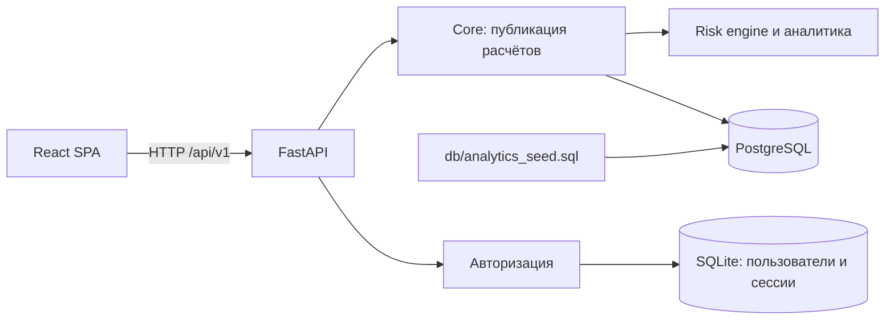

# Архитектура

Основное приложение состоит из FastAPI API, доменного ядра, PostgreSQL-хранилища и React SPA. Docker Compose запускает PostgreSQL, API и nginx для frontend.

## Компоненты

| Путь | Ответственность |
| --- | --- |
| `main.py`, `backend/app/main.py` | Создание FastAPI-приложения, lifespan, middleware и обработчики ошибок |
| `core.py` | Импорт снимка, расчёт новой версии и атомарная публикация результата |
| `backend/app/domain/` | Валидация, аналитика, скоринг, выручка, действия и настройки модели |
| `backend/app/storage.py`, `backend/app/db.py` | Версии источника, модели, расчёта, клиенты, аудит и индексы в SQLAlchemy |
| `backend/app/api/` | HTTP-маршруты, схемы и сериализация |
| `backend/app/auth/` | JWT-аутентификация основного API |
| `backend/app/ai/` | Необязательные AI-поверхности и локальный RAG |
| `frontend/src/` | React + TypeScript интерфейс |
| `backend/migrations/`, `db/` | Схема PostgreSQL и seed для Compose |

## Хранилища и версии

Аналитические данные и результаты расчёта находятся в PostgreSQL. Учетные записи и сессии авторизации хранятся отдельно в SQLite. Compose сохраняет PostgreSQL в `db/postgres/` и SQLite авторизации в именованном Docker volume.

Каждый опубликованный расчёт получает generation и ссылается на версии источника и настроек модели. Обновление снимка сначала валидируется целиком, затем рассчитывается и публикуется транзакционно. При ошибке текущая версия остаётся доступной. Экспорт CSV читает выборку страницами и закрепляет её за одной generation.

## Поток обработки

1. Снимок из `dataset/data.json`, SQL seed или API проходит проверку схемы и ссылок.
2. Доменное ядро рассчитывает факторы риска, категории, рекомендации и денежные показатели.
3. `Core` записывает результаты и метаданные версии в PostgreSQL.
4. API выдаёт опубликованную версию; frontend получает страницы клиентов, сводки и детали.

Risk engine подключается через `AEZA_ANALYTICS_FACTORY`. Для встроенного модуля задаётся `backend.app.domain.module:create`. Без модуля расчёта приложение не подставляет нулевые значения: readiness и аналитические маршруты сообщают, что расчёт недоступен.

## Ограничения

- Пересчёт выполняется внутри API-процесса; отдельной очереди фоновых задач нет.
- При `AEZA_AS_OF=now` включается периодический пересчёт, а зафиксированный ISO timestamp даёт воспроизводимую оценку.
- Датасет мал и синтетический. Score нельзя трактовать как откалиброванную вероятность или доказательство точности прогноза.
- Seed SQL применяется только при первом создании пустого тома PostgreSQL. Изменение seed-файла не обновляет уже созданную базу.
